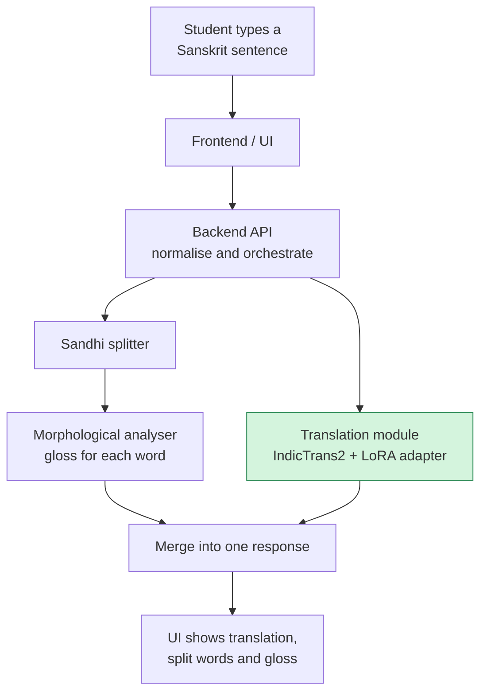

<div align="center">

# वाक्यसेतु · VākyaSetu

### A bridge from Sanskrit textbook sentences to understanding

Paste a Sanskrit sentence from your school textbook and get an English translation,
the sandhi split, and a word-by-word grammar breakdown.


</div>

---

## ✨ What it does

Sanskrit is taught in CBSE/NCERT schools (Deepakam, Ruchira, Shemushi, Manika/Sharada), but students
often cannot check their own understanding of a textbook sentence when no teacher is around.
VākyaSetu takes one Sanskrit sentence and returns three things:

| Output | What the student sees | Status |
|---|---|---|
| **English translation** | A fluent English rendering of the sentence | ✅ Done (this repo) |
| **Sandhi split** | Fused words separated into their parts | 🚧 In progress |
| **Word-level gloss** | Root, case, gender, number, tense for each word | 🚧 In progress |

It targets **everyday textbook prose, not classical or Vedic verse**, and is built by fine-tuning and
integrating existing Sanskrit NLP tools rather than inventing new foundations. Its limits are stated
openly (see [Known limitations](#-known-limitations)).

### 👀 A few real outputs

From our NCERT test sentences, produced by the fine-tuned model:

| Sanskrit | Model output | Verdict |
|---|---|---|
| आसीत् शोभावती नाम काचन नगरी। | There was a city named Shobhavati. | ✅ Close (the original says "a certain city") |
| इमौ बाहू, एष खड्गश्च। | These two are arms and this is the sword. | ✅ Handles the dual ("these two") and the singular "sword" |
| नैतच्छक्यम्! | Naithichakyam! | ❌ The fused word (न + एतत् + शक्यम्) is not understood. This is exactly why the sandhi splitter exists. |

---

## 🧭 How it works



The translation branch receives the original, unsplit sentence, because the model was trained on natural
text. Only the grammar branch uses the split words. More detail is in [`docs/architecture.md`](docs/architecture.md).

**Module contract:** the translation module takes a Sanskrit string and returns `{"translation": "..."}`.

---

## 🚀 Quick start: translation module

You need Python 3.11 and, ideally, an NVIDIA GPU (about 2 GB is enough; CPU works but is slow).
On Ubuntu/WSL also run `sudo apt install python3.11-dev`.

```bash
git clone https://github.com/satyam4896/Vakyasetu.git
cd Vakyasetu
python3.11 -m venv .venv && source .venv/bin/activate     # Windows: .venv\Scripts\activate
pip install -r requirements.txt
huggingface-cli login
```

The base model is gated: first accept its terms at
[ai4bharat/indictrans2-indic-en-dist-200M](https://huggingface.co/ai4bharat/indictrans2-indic-en-dist-200M),
then log in with a Hugging Face access token.

```python
from translator import Translator                 # ml/translator.py
t = Translator("models/adapter")                  # load ONCE, at server start-up
t.translate("बालकः विद्यालयं गच्छति।")             # -> {"translation": "..."}
```

- **Input:** Sanskrit in Devanagari. Several sentences are fine: the text is split after `।  ॥  ?  !`
  and at line breaks, and each sentence is translated separately.
- **Errors:** `ValueError` with a readable message for empty, over-long (more than 1,000 characters) or
  non-Devanagari input. The backend should return it as an HTTP 400.
- Requests are handled one at a time. The first call after start-up is slow, so the module runs a
  warm-up sentence when it loads.
- Check everything end to end: `python -u ml/scripts/check_translator.py --adapter models/adapter`

> **Pinned versions matter.** `transformers==4.46.3`, `peft==0.13.2` and `huggingface_hub<1.0` are pinned
> because IndicTransToolkit breaks on newer `transformers`. Do not upgrade them casually.

---

## 📊 Results

BLEU / chrF on the official Sāmayik **test split** (2,417 sentences). The base model is the unmodified
IndicTrans2. "Modern" means the reference English contains no King-James-style words.

| Subset | Sentences | Base model | **Fine-tuned** |
|---|---|---|---|
| All | 2,417 | 19.6 / 44.4 | **24.3 / 48.7** |
| Modern-English references | 2,224 | 21.4 / 46.5 | **26.3 / 50.6** |
| Bible-style references | 193 | 8.7 / 32.4 | **14.4 / 37.9** |

On modern-English references, fine-tuning adds about **+4.9 BLEU and +4.1 chrF** over the base model.

**An honest caveat.** The test split comes from the same sources as the training data, so it says little
about NCERT textbook Sanskrit. We also scored 11 NCERT sentences against draft reference translations
(chrF 33.2 fine-tuned vs 31.9 base; BLEU 9.0 vs 11.1). That set is too small for reliable scores. Reading the
outputs, number agreement and some question words improved, but story sentences sometimes come out in
Bible-style English ("And behold… unto…"), and one sentence got worse.

---

## 🔬 How the translation model was built

1. **Data:** Sāmayik, an English–Sanskrit corpus (train 43,493, validation 2,416, test 2,417,
   out-of-domain test 4,047). Cleaning (training rows only; validation and test are never filtered) leaves
   **42,826** training pairs. It removes empty rows, English copied into the Sanskrit side, Sanskrit copied
   into the English side, extreme length ratios, duplicates, and sentences that also appear in validation or
   test. Quotation marks wrapping about half of all sentences are stripped from every split.
2. **Method:** LoRA (r=16, α=32 on `q_proj` and `k_proj`), which trains 1.77M of 213.6M parameters (0.83%).
3. **Training:** 4,000 steps at an effective batch of 32 (about 3 passes over the data), on a laptop
   RTX 2050 with 4 GB, in about 2.6 hours. The checkpoint with the best dev BLEU (step 2500) is the adapter in
   `models/adapter/`.
4. **Evaluation:** base vs fine-tuned on the same sentences, split by whether the reference English is
   Bible-style.

### What we learned

- **About 8% of Sāmayik is Bible text** (3,511 training rows contain King-James words such as "unto" and
  "behold"). The fine-tuned model reproduces that style on story-like sentences, which is a poor fit for
  school textbooks.
- **Removing those rows did not help in our first attempt.** That model ("run 3") stopped early at step 2000
  because dev BLEU peaked at step 500, and it scored lower on the test split (24.1 vs 26.3 BLEU on modern
  references). The comparison is unfair, because that run saw far less training. A rerun that picks its
  checkpoint by dev loss is listed under the roadmap.
- **Small dev sets are noisy.** Dev BLEU on 200 sentences moved by up to 2.8 points between neighbouring
  checkpoints, so picking a checkpoint by it is risky. Dev loss is steadier.

---

## ⚠️ Known limitations

These are shown to users in the interface, not hidden.

- Sandhi-heavy sentences and long compounds often fail, in both the base and the fine-tuned model.
- The model sometimes writes King-James-style English (see above).
- It translates one sentence at a time and cannot use dialogue context. Words such as देव (king / God) and
  वर्तनम् (wages / conduct) can be mistranslated.
- `no_repeat_ngram=3` is on by default to stop repetition loops. We checked it on only 11 sentences.
- The 11 NCERT reference translations are drafts and may not all have been checked by a Sanskrit reader.

**Out of scope on purpose:** speech input or output, full *anvaya* (formal word-order rearrangement),
perfect sandhi splitting (an open problem in Sanskrit NLP, so the system should surface uncertainty
instead of guessing), and classical or Vedic verse.

---

<details>
<summary><b>🔁 Reproduce the training and evaluation</b></summary>

Run from the repo root with the virtual environment active.

```bash
# 1. Clean the dataset (add --examples to see sample rows of each flagged category)
python ml/scripts/inspect_samayik.py                  # report only
python ml/scripts/inspect_samayik.py --write          # writes data/processed/

# 2. Convert to the folder layout IndicTrans2's LoRA script expects
python ml/scripts/prepare_lora_data.py --out-dir data/lora_full --dev-size 200

# 3. Train (about 2.6 hours on a 4 GB GPU); apply the toolkit patch below first
nohup bash ml/scripts/train_run2.sh > ml/outputs/run2_full.log 2>&1 &
tr '\r' '\n' < ml/outputs/run2_full.log | tail -3            # watch progress
python ml/scripts/training_curve.py ml/outputs/run2_full.log

# 4. Evaluate base vs fine-tuned, then split the scores by reference style
python ml/scripts/evaluate_models.py --adapter ml/checkpoints/run2_full \
    --data data/processed/test.tsv --name test_full_run2
python ml/scripts/score_by_style.py ml/outputs/eval_test_full_run2.csv
```

Expected data sizes: train 43,493 → 42,826 after cleaning; validation 2,416; test 2,417; test_ood 4,047.
Results will be close to those above but not bit-for-bit identical (GPU nondeterminism).

**Toolkit patch (training only; inference does not need it).** IndicTransToolkit's `collator.py` has imports
inside a class body, which raises a `NameError` during training. Patch it once after installing:

```bash
F=$(python -c "import importlib.util, os; print(os.path.join(os.path.dirname(importlib.util.find_spec('IndicTransToolkit').origin), 'collator.py'))")
cp "$F" "$F.bak"
sed -i '1i from transformers.utils import PaddingStrategy\nfrom transformers.tokenization_utils import PreTrainedTokenizerBase\nfrom transformers.data.data_collator import pad_without_fast_tokenizer_warning' "$F"
```

Run it once only. Reinstalling the toolkit removes the patch.

</details>

<details>
<summary><b>🗂️ Repository layout</b></summary>

```
.
├── README.md
├── requirements.txt
├── docs/                      architecture notes
├── models/
│   └── adapter/               final LoRA adapter (about 7 MB)
├── ml/
│   ├── translator.py          the module the backend imports
│   ├── scripts/
│   │   ├── inspect_samayik.py       download, inspect and clean the dataset
│   │   ├── prepare_lora_data.py     convert to the training layout
│   │   ├── train_lora_vs.py         IndicTrans2's LoRA trainer (one small edit)
│   │   ├── train_run2.sh            the exact command behind the final adapter
│   │   ├── evaluate_models.py       base vs fine-tuned on the same sentences
│   │   ├── score_by_style.py        scores split by modern vs Bible-style references
│   │   ├── bible_style_check.py     measures Bible-style text in data and outputs
│   │   ├── training_curve.py        prints the evaluation curve of a run
│   │   ├── check_translator.py      end-to-end check of the translator
│   │   └── baseline_inference.ipynb first notebook: base model on NCERT sentences
│   ├── data/                  small hand-written files (NCERT test sentences)
│   └── outputs/               small result files (NCERT evaluations, scores)
├── backend/                   coming: API that merges the three modules
├── frontend/                  coming: the web interface
└── data/                      generated, git-ignored (processed/, lora_full/, ...)
```

</details>

---

## 🛣️ Roadmap

- [x] Clean the Sāmayik data and fine-tune IndicTrans2 with LoRA
- [x] Evaluate against the base model on the official test split
- [x] Translation module with a stable `{"translation": ...}` contract
- [ ] Sandhi splitting and morphological gloss modules
- [ ] Backend that merges the three outputs, and the web interface
- [ ] A larger NCERT test set (50–100 sentences) with references checked by a Sanskrit reader
- [ ] A fair rerun of the Bible-filtered training, selecting the checkpoint by dev loss
- [ ] Evaluate on the out-of-domain test split (radio talks)
- [ ] Try sandhi-aware translation, and more LoRA target modules

---

## 👥 Team

| Member | Owns |
|---|---|
| **Satyam** | Repository setup, IndicTrans2 fine-tuning, translation module, data pipeline, evaluation |
| **Mayank** | Sandhi splitting, frontend and interface |
| **Shrinivas** | Morphological analysis, backend orchestration and integration |

## 🙏 Acknowledgements

- [IndicTrans2](https://github.com/AI4Bharat/IndicTrans2) by AI4Bharat: the base translation model and LoRA training script
- *Sāmayik: A Benchmark and Dataset for English-Sanskrit Translation* (LREC-COLING 2024): the training data
- [sanskrit_parser](https://github.com/kmadathil/sanskrit_parser) and the
  [Sanskrit Heritage Reader](https://sanskrit.inria.fr): sandhi and morphology tools
- Hugging Face `transformers` and `peft`

## 📄 License

To be decided by the team (MIT is a common choice for student projects). Check the Sāmayik repository's
terms before redistributing the dataset or weights trained on it.