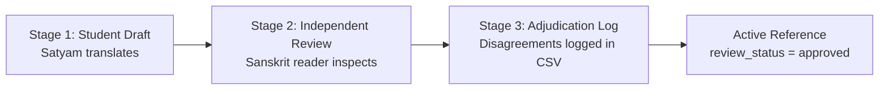

# VākyaSetu: NCERT Sanskrit Evaluation Protocol & Benchmark Specification

This directory houses the curated, textbook-aligned evaluation corpus for VākyaSetu, sampling sentences from official NCERT Sanskrit textbooks across Classes 6 through 10.

---

## 1. Motivation: Why an NCERT Benchmark?

Our primary training and test splits come from the **Sāmayik** dataset (`acomquest/Saamayik`). While valuable, Sāmayik's test split is drawn from the same underlying distributions (1851 Bible, Spoken Tutorials, NIOS, Gitasopanam). High scores on Sāmayik do not prove that the model understands middle- and high-school Sanskrit curriculum prose.

This evaluation suite bridges that gap by testing the model directly on authentic CBSE/NCERT textbook sentences.

---

## 2. Fair-Dealing Legal Boundaries & Copyright Compliance

To strictly adhere to Indian Copyright Law (**Indian Copyright Act, 1957, Section 52(1)(a)(i) and Section 52(1)(h)** regarding fair dealing for research, private study, criticism, and review):

1. **Strict Sampling Limits**: We extract a maximum of **3 to 8 isolated, non-contiguous sentences** per textbook chapter.
2. **No Full Works**: Entire stories, contiguous dialogues, chapters, or complete poetry verses are **never** reproduced in this repository.
3. **Academic Attribution**: Every sentence records its originating Class, Book title, Chapter number, and Chapter title for scholarly attribution.
4. **Non-Commercial Research Purpose**: The data is used solely as a ground-truth linguistic probe to evaluate machine translation errors.

---

## 3. CSV Dataset Schema (`ncert_eval_gold.csv`)

The benchmark is structured as a UTF-8 CSV with the following columns:

| Column | Type | Description | Permitted / Example Values |
|---|---|---|---|
| `id` | string | Unique benchmark identifier | `NCERT-CL06-01`, `NCERT-CL09-12` |
| `class` | int | CBSE school grade | `6`, `7`, `8`, `9`, `10` |
| `book` | string | Standard textbook title | `Ruchira I`, `Ruchira II`, `Ruchira III`, `Shemushi I`, `Shemushi II` |
| `chapter_no` | int | Textbook chapter index | `1`, `2`, `7` ... |
| `chapter_title` | string | Sanskrit chapter title | `बकस्य प्रतीकारः`, `स्वर्णकाकः`, `डिजीभारतम्` |
| `sanskrit` | string | Input Sanskrit text (NFC-normalized Devanagari) | `बालकः विद्यालयं गच्छति।` |
| `student_translation` | string | Initial draft translation produced by Satyam | `The boy goes to school.` |
| `reviewer_translation` | string | Corrected translation by a Sanskrit-literate reader | `The boy walks to school.` |
| `reference_english` | string | Active reference string used by evaluation tools | (Defaults to reviewer if reviewed, else student) |
| `review_status` | string | Editorial verification stage | `draft`, `reviewed`, `approved` |
| `disagreement_notes` | string | Rationale for corrections / alternative readings | Notes on honorifics, polysemy (*deva*, *vartanam*), dative vs genitive |
| `has_sandhi` | int (0/1) | Whether the sentence contains fused sandhi boundaries | `1` (fused), `0` (split/unfused) |
| `has_compound` | int (0/1) | Whether the sentence contains nominal compounds (*samāsa*) | `1` (compound present), `0` (none) |
| `sentence_type` | string | Pedagogical discourse category | `story`, `dialogue`, `question`, `grammar_exercise` |
| `tense` | string | Grammatical lakāra / tense of the primary verb | `present_lat`, `past_lan`, `future_lrt`, `imperative_lot`, `potential_vidhilin`, `nominal_none` |

---

## 4. The 3-Stage Reference Curation & Adjudication Protocol

To prevent subjective bias and ensure gold reference quality, references follow a formal 3-stage protocol:



1. **Stage 1 (Student Draft)**: Satyam extracts the textbook sentence and writes a faithful, natural modern English translation in `student_translation`.
2. **Stage 2 (Sanskrit Reader Verification)**: An independent Sanskrit-literate reviewer checks the sentence against Paninian grammar, case relations (*kārakas*), and narrative context.
3. **Stage 3 (Adjudication & Notes)**:
   - When the reviewer modifies the translation, the change and rationale are explicitly recorded in `disagreement_notes` (e.g., *"Kuru is imperative lot; dinner vs meal"*).
   - If both agree or resolve the difference, `review_status` advances from `draft` to `reviewed` and finally `approved`.
   - The active evaluation script reads `reference_english`.

---

## 5. Statistical Evaluation Methodology

### 5.1 Why chrF is the Primary Metric (BLEU Secondary)
Sanskrit is a synthetic, highly inflected language, while English is analytic. Word order in Sanskrit is flexible. Traditional word-level BLEU penalizes valid synonym choices and slight clause-order shifts heavily on small test sets ($N \approx 100$).  
**chrF (character n-gram F-score)** measures subword and morphological overlap, making it far more robust, monotonic, and reflective of translation quality on student sentences.

### 5.2 Paired Bootstrap Resampling
We use **$B = 1,000$ paired bootstrap resamples** to establish 95% percentile confidence intervals for chrF and BLEU, reporting empirical one-sided $p$-values testing whether the fine-tuned adapter significantly outperforms the base model ($H_0: \Delta \le 0$).

### 5.3 Faceted Per-Tag Breakdowns
The evaluation script automatically slices the benchmark across tags to isolate failure modes:
- **`has_sandhi = 1` vs `has_sandhi = 0`**: Quantifies how much unsegmented sandhi degrades the neural model.
- **`has_compound = 1` vs `has_compound = 0`**: Measures performance on multi-word nominal compounds (*samāsa*).
- **`class = 6 ... 10`**: Measures curriculum progression degradation as syntax complexity increases from Class 6 to Class 10.
- **`sentence_type`**: Compares dialogue and questions against narrative story prose.

---

## 6. How to Run the Benchmark

### Full Evaluation on GPU:
```bash
python3 ml/scripts/evaluate_models.py \
    --adapter models/adapter \
    --data ml/data/ncert_eval_gold.csv \
    --name ncert_gold \
    --no-repeat-ngram 3 \
    --resamples 1000
```

### Fast Mock Evaluation (Runs in <2 seconds on any CPU):
```bash
python3 ml/scripts/evaluate_models.py \
    --adapter models/adapter \
    --data ml/data/ncert_eval_gold.csv \
    --name test_mock \
    --mock \
    --resamples 200
```
